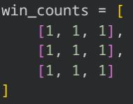
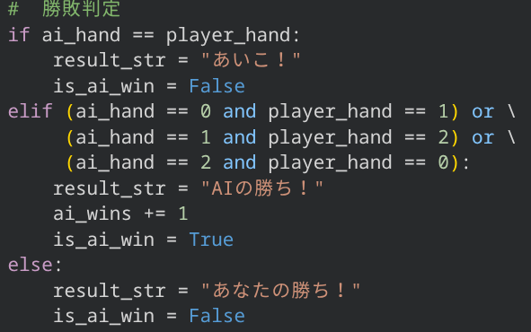
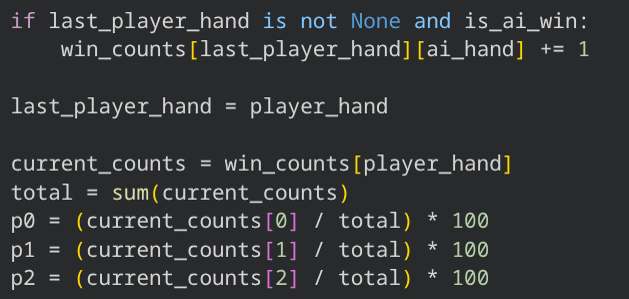
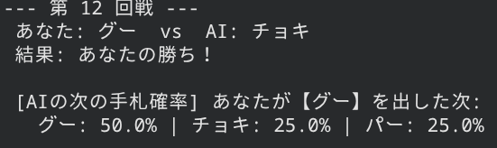

## しくみ

「プレイヤーが直前に出した手」と「CPU が出した手」の組み合わせごとに、勝った回数をカウントします。
カウントはそのまま `random.choices` の重みになるため、勝率の高い手が自然と選ばれやすくなります。

### 1. 勝ち数の表を用意する

3×3 の 2 次元リストを、すべて `1` で初期化します（0 除算を防ぐため）。

### 2. 勝敗を判定する

あいこ・AI の勝ち・プレイヤーの勝ちを判定し、AI が勝ったときだけ勝ち数を数えます。

### 3. 勝った手の重みを増やす

勝った組み合わせのカウントを +1 し、次の手を出す確率を計算して表示します。

### 4. 実行結果の例

12回ぐらい進めた表示例です。プレイヤーがグーを出したあとの CPU の手札確率が表示されます。

